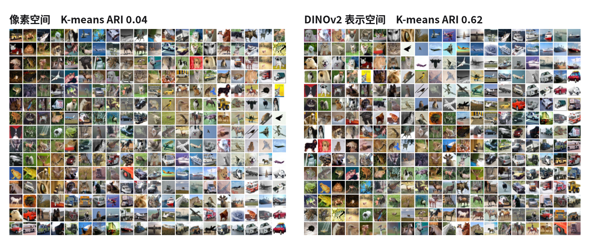

# 深度聚类：范式演进、对照实验与方法选择



面对一批没有标签的图像，应该先改进表示，还是先换一个更复杂的聚类器？这个仓库用统一协议比较了经典聚类、自编码器系的深度聚类（AE + K-means、DEC、IDEC）、生成式的 VaDE、对比学习（SimCLR + K-means、CC）和冻结的预训练模型（DINOv2、CLIP），并把结论整理成一份 24 页的课程汇报。

## 主要结论

- **表示比聚类器更重要，但最好的表示取决于领域。** 在三个数据集上，换表示让 ARI 最多变化 0.60，同一表示上换聚类器平均只变化 0.1 左右。冻结的 DINOv2 特征加 K-means 在 CIFAR-10 上得到 0.62（从零训练的九种方法都不超过 0.06），在 Fashion-MNIST 上得到 0.53（DEC 为 0.44）；但在手写数字 MNIST 上只有 0.32，不如在本数据上训练的自编码器（0.59）。
- **联合优化有条件地有效。** 干净、充足的数据上 DEC 最好（MNIST ARI 0.669）；但测试图加噪后 DEC 只保留 47% 的 ARI，像素 K-means 保留 93%；训练图很少时，K-means 也比 DEC 好。
- **有了预训练表示，简单聚类器就够了。** 在冻结的 DINOv2 / CLIP 特征上，GMM 平均比 K-means 低 0.04，DEC 聚类头在 6 组中全部更低。
- **没有标签时，稳定不等于正确。** 用加噪前后簇成员的一致度挑方法，三个数据集上选中的都是经典方法，而 ARI 最高的都是深度方法。

## 汇报

| 文件 | 内容 |
| --- | --- |
| [presentation/deep-clustering-evolution-selection-guide.pptx](presentation/deep-clustering-evolution-selection-guide.pptx) | 24 页正文 + 6 页附录，可编辑；备注中是逐页讲稿 |
| [presentation/deep-clustering-evolution-selection-guide.pdf](presentation/deep-clustering-evolution-selection-guide.pdf) | 同一份幻灯片的 PDF |
| [presentation/speaker_notes.docx](presentation/speaker_notes.docx) | 可打印的讲稿 |
| [presentation/outline.md](presentation/outline.md) | 每页的结论与证据 |

幻灯片由 `scripts/build_pptx.py` 生成，页面上的数字和讲稿里的数字都在构建时从 `results/tables` 读取。

## 实验怎样保证可比较

- 数据集为 MNIST、Fashion-MNIST 和 CIFAR-10，所有方法使用相同的切分和预先固定的配置（`configs/protocol.yaml`）。
- `fit` 不接收标签。测试标签只在评价步骤读取；类别不平衡子集只用训练集标签构造比例。
- 早停只看训练集簇分配的变化，追加训练轮数只看训练损失是否还在下降。
- 主要对比都重复 3 个随机种子。最初只跑了 1 个种子的消融和编码器 × 聚类器实验，其余种子在运行前登记进同一份协议后补齐。
- 所有表和图由 `scripts/analyze.py` 从 `results/raw` 的原始记录生成，缺失的结果保持为空。

## 从哪里看

| 看什么 | 文件 |
| --- | --- |
| 从零训练基准 | [results/tables/e01_summary.csv](results/tables/e01_summary.csv)、[benchmark_ari.png](results/figures/benchmark_ari.png) |
| 编码器 × 聚类器 | [results/tables/e04_summary.csv](results/tables/e04_summary.csv)、[representation_vs_clusterer.png](results/figures/representation_vs_clusterer.png) |
| 测试噪声 | [results/tables/e03_noise.csv](results/tables/e03_noise.csv)、[noise_robustness.png](results/figures/noise_robustness.png) |
| 样本量与其他敏感性 | [results/tables/e03_sensitivity_summary.csv](results/tables/e03_sensitivity_summary.csv) |
| IDEC 组件与 λ | [results/tables/e02_summary.csv](results/tables/e02_summary.csv)、[results/tables/e02_fixed_epochs.csv](results/tables/e02_fixed_epochs.csv) |
| 训练成本 | [results/tables/benchmark_cost_frontiers.csv](results/tables/benchmark_cost_frontiers.csv) |
| 无标签稳定性诊断 | [results/tables/selection.json](results/tables/selection.json) |
| 原始运行记录 | [results/raw/](results/raw/) |

## 如何运行

完整流程见 [WORKFLOW.md](WORKFLOW.md)。只重建图表和幻灯片：

```bash
python scripts/analyze.py
python scripts/build_pptx.py
python scripts/export_notes_docx.py
python -m unittest discover -s tests -v
```

## 文档

- [实验协议](docs/experiment_protocol.md)：数据切分、损失、早停、标签隔离和运行覆盖。
- [文献综述](docs/literature_review.md)：DEC、IDEC、VaDE、SimCLR、CC 与预训练方法的原始定义。
- [数学基础](docs/mathematical_foundations.md)：从 K-means、GMM、PCA 到深度聚类目标函数。
- [方法选择](docs/method_selection.md)：带标签基准与无标签诊断各自能回答什么。
- [分类框架](docs/taxonomy.md)：表示与聚类的四种配合方式。

## 局限

实验假设簇数 K 已知。SimCLR 和 CC 使用课程规模的小型 CNN、训练 100 轮，CC 省略了原论文的簇熵正则；VaDE 的重构项是每张图的平方误差，GMM 使用标准化后的对角协方差。只有三个小规模图像数据集；DINOv2 与 CLIP 含外部预训练数据，成本不能与从零训练直接比较。

本仓库使用 MIT License。
