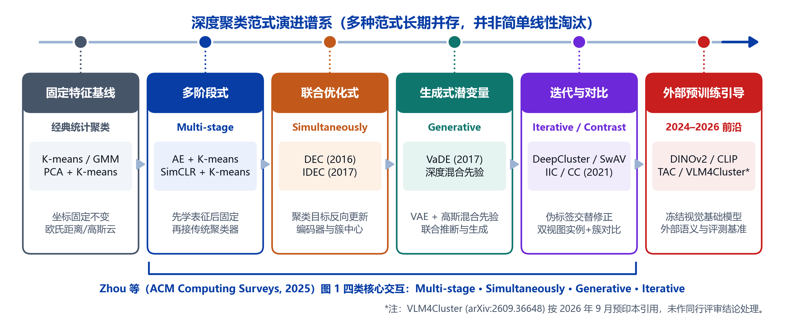

# 深度聚类：从原理到方法选择



实验比较经典聚类、表征学习、联合优化、生成式模型、对比聚类和外部预训练特征，回答一个实际问题：**面对新的图像数据，应该先改善表示，还是先更换聚类器？**

## 这份研究讲了什么

- **表示通常比聚类器更重要。** 原始像素距离缺少语义，先学习合适的隐空间往往比在原始空间换用更复杂的聚类器有效。
- **联合优化有条件地有效。** DEC 和 IDEC 在干净、样本充足的数据上有优势，噪声和极小样本会改变方法顺序。
- **预训练特征改变了比较方式。** 在自然图像上，冻结 DINOv2 或 CLIP 特征再做 K-means 是强基线，复杂聚类头需要单独证明收益。
- **训练稳定不等于语义正确。** E05 只用于发现坍缩和退化风险，不能代替少量标注验证，也不能自动宣布最佳方法。

## 实验怎样保证可比较

- 数据集包括 MNIST、Fashion-MNIST 和 CIFAR-10，所有方法使用统一切分和预先固定的配置。
- `fit` 阶段不接收标签。测试标签只在评价步骤读取，类别不平衡子集只用训练集标签构造比例。
- 早停只看训练集簇分配变化，追加 epoch 只看训练损失是否继续下降。
- 所有汇总表和图由 `scripts/analyze.py` 从原始运行记录生成，空白结果保持为空。

## 从哪里看

| 看什么 | 文件或目录 |
| --- | --- |
| 三数据集基准结果 | [results/tables/e01_summary.csv](results/tables/e01_summary.csv) |
| E01 ARI 总览图 | [results/figures/fig_e01_ari.png](results/figures/fig_e01_ari.png) |
| λ、隐空间和组件消融 | [results/tables/e02_ablation.csv](results/tables/e02_ablation.csv) |
| 噪声与敏感性实验 | [results/tables/e03_noise.csv](results/tables/e03_noise.csv)、[results/tables/e03_sensitivity.csv](results/tables/e03_sensitivity.csv) |
| 预训练表示与聚类器对照 | [results/tables/e04_paired.csv](results/tables/e04_paired.csv)、[results/tables/e04_pretrained.csv](results/tables/e04_pretrained.csv) |
| 无标签稳定性诊断 | [results/tables/selection.json](results/tables/selection.json) |
| 原始运行记录 | [results/raw/](results/raw/) |

## 如何运行

在 WSL2 中执行：

```bash
bash scripts/setup_wsl.sh
bash scripts/launch_wsl.sh
```


运行自动化测试：

```bash
python -m unittest discover -s tests -v
```

## 文档导航

- [实验协议](docs/experiment_protocol.md) 说明实验规则和标签隔离。
- [文献综述](docs/literature_review.md) 用论文原始定义解释 DEC、IDEC、VaDE、SimCLR、CC 和预训练方法。
- [数学基础](docs/mathematical_foundations.md) 连接 K-means、GMM、PCA 与深度聚类目标函数。
- [方法选型](docs/method_selection.md) 区分历史带标签基准和无标签稳定性诊断。
- [分类框架](docs/taxonomy.md) 用表征空间、优化交互、聚类机制和监督信号四个维度整理方法。
- [完成记录](docs/change_log.md) 按日期记录本轮修改、验证和已知限制。

## 局限性

SimCLR 和 CC 使用课程版小型 CNN，CC 省略原论文的边际簇熵项。VaDE 的重构项是每张图的平方误差，GMM 使用标准化后的对角协方差。E02、E03 和 E04 的部分比较使用单个 seed，预训练模型含外部数据预算。结论只适用于当前协议和实现边界。

本仓库使用 MIT License。
